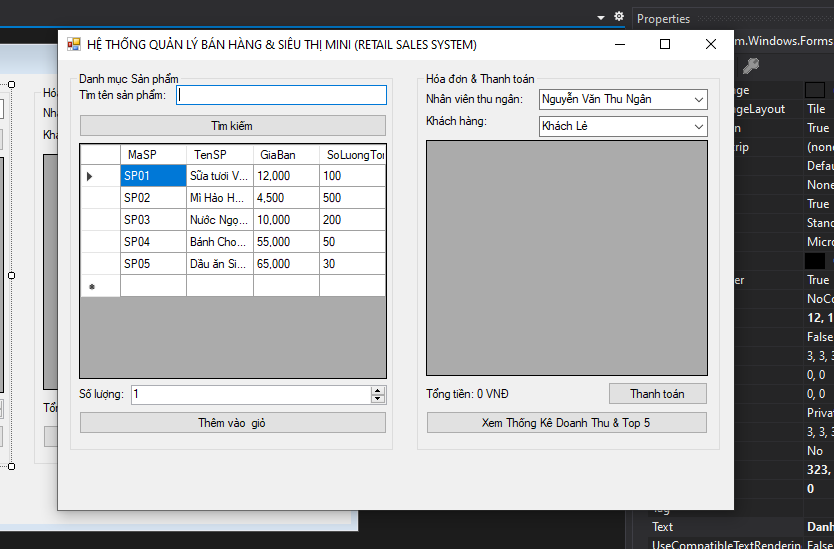
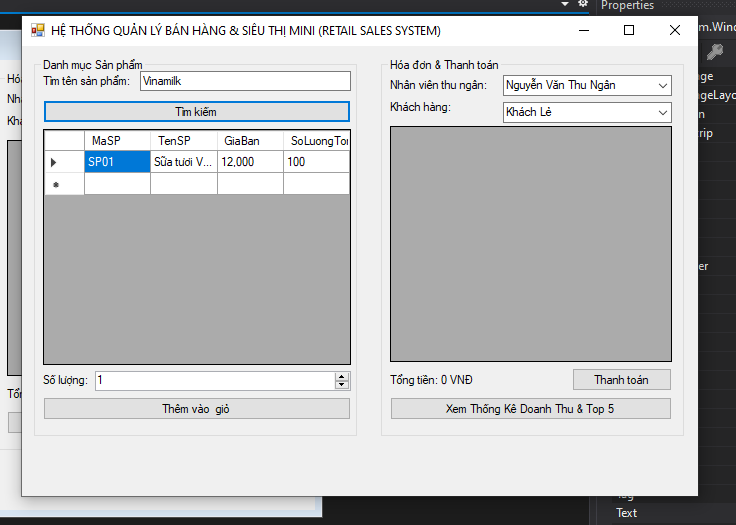
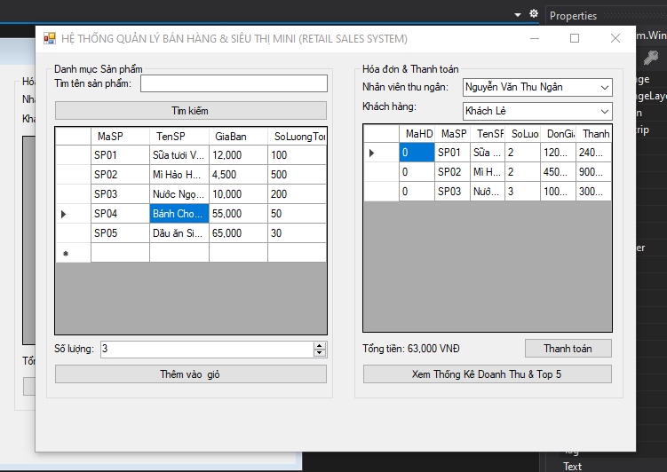
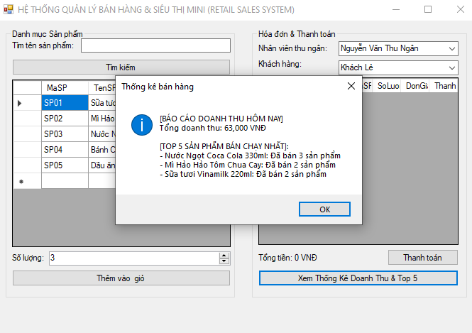
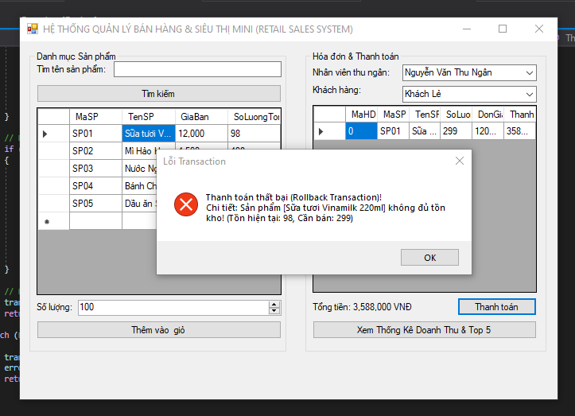
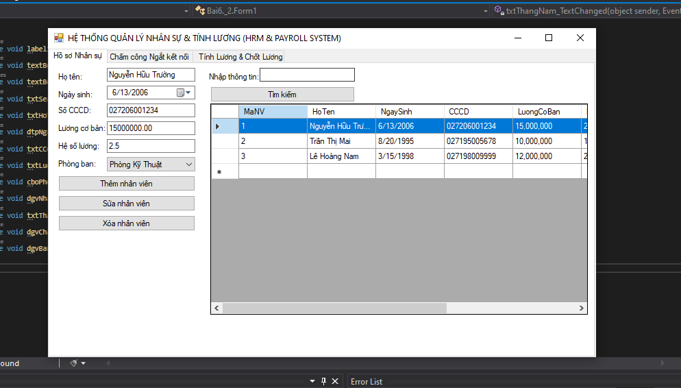
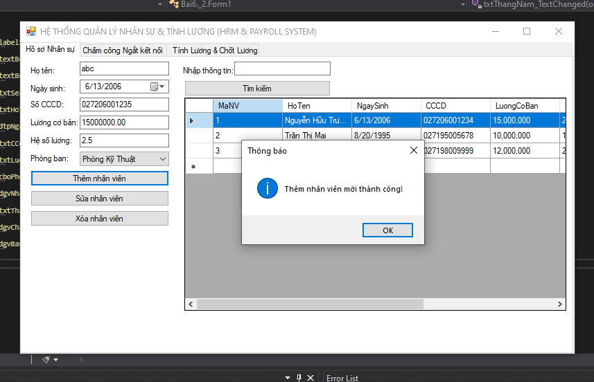
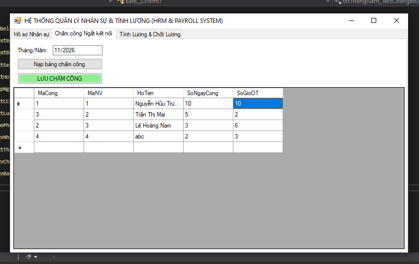
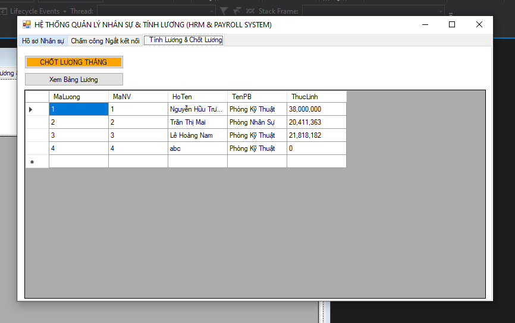
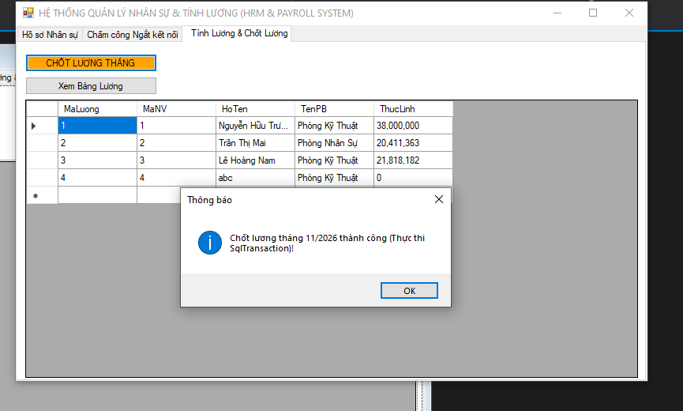

# BÁO CÁO BÀI TẬP THỰC HÀNH C# WINFORMS (3-TIER ARCHITECTURE)

## MỤC 1: THÔNG TIN SINH VIÊN
* **Họ và tên sinh viên:** Nguyễn Văn An
* **Mã sinh viên:** 24810320020
* **Lớp / Khóa:** D19QTANM1

---

## MỤC 2: HÌNH ÁNH KẾT QUẢ CÁC MÀN HÌNH CHỨC NĂNG

### BÀI TẬP 6.1: HỆ THỐNG QUẢN LÝ BÁN HÀNG & SIÊU THỊ MINI (RETAIL SALES SYSTEM)

1. **Màn hình Chính / Tổng quan hệ thống:**

2. **Màn hình Quản lý Danh mục (CRUD - Tìm kiếm Sản phẩm):**

3. **Màn hình Thực thi Nghiệp vụ chính (Bán hàng & Giỏ hàng):**

4. **Màn hình Báo cáo - Thống kê (Doanh thu & Top 5):**

5. **Minh họa An toàn Dữ liệu (Báo lỗi Transaction Rollback):**

---

### BÀI TẬP 6.2: HỆ THỐNG QUẢN LÝ NHÂN SỰ & TÍNH LƯƠNG (HRM & PAYROLL SYSTEM)

1. **Màn hình Chính / Tổng quan hệ thống:**

2. **Màn hình Quản lý Danh mục (CRUD - Hồ sơ Nhân viên):**

3. **Màn hình Thực thi Nghiệp vụ chính (Chấm công ngắt kết nối):**

4. **Màn hình Báo cáo - Thống kê (Bảng Lương chi tiết):**

5. **Minh họa An toàn Dữ liệu (Chốt Lương SqlTransaction):**
